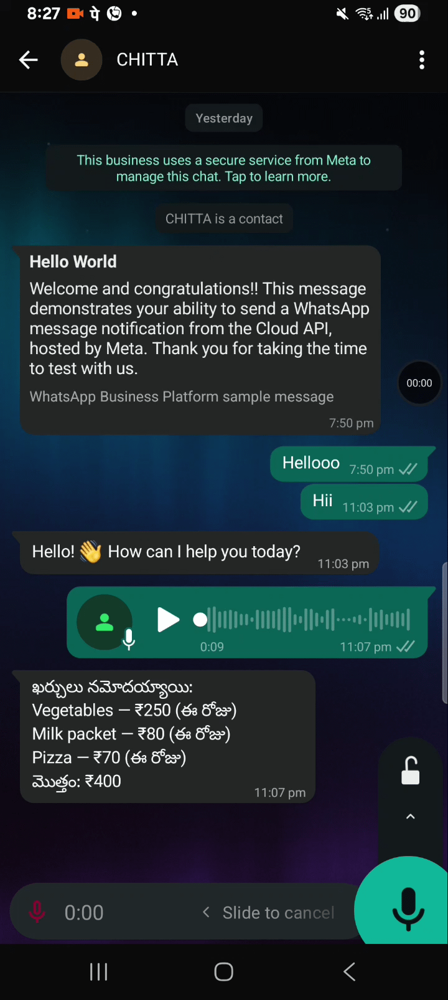
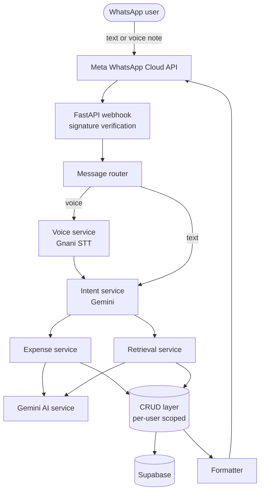

# CHITTA

### చిట్టా · *CHIT-taa*

**Your money, in order.**

CHITTA is a modern digital version of the traditional Indian account book. A *chitta* is an account, list, or written statement kept by hand; CHITTA keeps yours through conversation. Log an expense, ask about your spending, or send a voice note, all in plain language on WhatsApp, with no forms and no separate app.

> "Spent ₹250 on lunch"
> "How much did I spend on food this month?"

[](https://www.python.org/)
[](https://fastapi.tiangolo.com/)
[](https://supabase.com/)
[](https://ai.google.dev/)
[](https://developers.facebook.com/docs/whatsapp/cloud-api)

## 🎥 CHITTA in action



*Track expenses, send voice notes, and retrieve
your spending history — all through WhatsApp.*


## Table of contents

- [About the name](#about-the-name)
- [Features](#features)
- [Example conversations](#example-conversations)
- [Telugu examples](#telugu-examples)
- [Architecture](#architecture)
- [Request flow](#request-flow)
- [Project structure](#project-structure)
- [Tech stack](#tech-stack)
- [Security and privacy](#security-and-privacy)
- [Getting started](#getting-started)
- [Configuration](#configuration)
- [Roadmap](#roadmap)
- [Design principles](#design-principles)


## Features

| | Capability | Description |
|---|---|---|
| 💬 | **Natural-language logging** | Record expenses by typing them the way you'd say them. |
| 🗣 | **Telugu and English** | Write in Telugu, English, or a mix of both. See [Telugu examples](#telugu-examples). |
| 🎙 | **Voice notes** | Send a WhatsApp voice note; speech is transcribed with Gnani STT and handled like text. |
| 🤖 | **Intent detection** | Gemini decides whether you are saving or asking. |
| 🏷 | **Auto-categorisation** | Category, item, and amount are extracted into validated, structured data. |
| 🔍 | **Conversational retrieval** | Ask for expenses by category, item, or period and get readable answers. |
| 🔐 | **Secure by design** | Signed-webhook verification and per-user data isolation. |
| 🧱 | **Modular architecture** | API, services, database, and prompts are cleanly separated. |


## Example conversations

**Save an expense**

```
You:    Spent ₹180 on lunch
CHITTA: ✅ Expense saved!

        Item: Lunch
        Category: Food
        Amount: ₹180
```

**Retrieve expenses**

```
You:    Show all my food expenses
CHITTA: 🍔 Lunch    ₹180
        🍕 Pizza    ₹450
        🍟 Fries    ₹120
```

**Voice note**

```
You:    🎙 (voice note: "Paid two hundred for auto today")
CHITTA: ✅ Expense saved!

        Item: Auto
        Category: Transport
        Amount: ₹200
```


## Telugu examples

CHITTA understands Telugu, English, and the mix most people actually type.

**Save an expense in Telugu**

```
You:    ఈరోజు లంచ్ కి ₹180 ఖర్చు చేశాను
CHITTA: ✅ ఖర్చు సేవ్ అయింది!

        వస్తువు: లంచ్
        వర్గం: ఆహారం
        మొత్తం: ₹180
```

**Telugu written in English letters**

```
You:    Auto ki 200 ichanu
CHITTA: ✅ ఖర్చు సేవ్ అయింది!

        వస్తువు: ఆటో
        వర్గం: రవాణా
        మొత్తం: ₹200
```

**Ask in Telugu**

```
You:    ఈ నెల ఆహారం మీద ఎంత ఖర్చు చేశాను?
CHITTA: 🍔 లంచ్    ₹180
        🍕 పిజ్జా   ₹450
        🍟 ఫ్రైస్   ₹120

        ఈ నెల ఆహారంపై మొత్తం: ₹750
```

**Telugu voice note**

```
You:    🎙 (voice note: "ఆటోకి రెండు వందలు ఇచ్చాను")
CHITTA: ✅ ఖర్చు సేవ్ అయింది!

        వస్తువు: ఆటో
        వర్గం: రవాణా
        మొత్తం: ₹200
```


## Architecture




## Request flow

1. The user sends a text or voice message on WhatsApp.
2. Meta Cloud API delivers it to the FastAPI webhook, which verifies the request signature.
3. The message router identifies the user by their WhatsApp number. Voice notes are transcribed first.
4. The intent service asks Gemini whether the message is an expense or a retrieval request.
5. The matching service runs, using Gemini for extraction and the CRUD layer for data.
6. The formatter shapes the result and CHITTA replies on WhatsApp.


## Project structure

```
chitta/
│
├── app/
│   ├── api/
│   │   └── whatsapp.py
│   │
│   ├── database/
│   │   ├── database.py
│   │   ├── crud.py
│   │   └── database_models.py
│   │
│   ├── models/
│   │   └── schemas.py
│   │
│   ├── prompts/
│   │   ├── intent_prompt.py
│   │   ├── expense_prompt.py
│   │   └── retrieval_prompt.py
│   │
│   ├── services/
│   │   ├── message_service.py
│   │   ├── intent_service.py
│   │   ├── expense_service.py
│   │   ├── retrieval_service.py
│   │   ├── speech_to_text_service.py
│   │   ├── gemini_service.py
│   │   └── whatsapp_service.py
│   │
│   ├── utils/
│   │   ├── webhook_security.py
│   │   ├── messages.py
│   │   ├── formatter.py
│   │   └── whatsapp_formatter.py
│   │
│   ├── config.py
│   └── main.py
│
├── .env.example
├── .gitignore
├── requirements.txt
└── README.md
```

---

## Tech stack

| Technology | Purpose |
|---|---|
| Python | Backend language |
| FastAPI | Webhook and API framework |
| SQLAlchemy | ORM |
| Supabase | Database |
| Google Gemini | Intent detection and extraction |
| Gnani STT | Voice-note transcription |
| Meta WhatsApp Cloud API | Messaging platform |
| Pydantic | Data validation |
| ngrok (development) | Public webhook tunnel |

---

## Security and privacy

- **Webhook signature verification.** Incoming requests are validated against Meta's signature so only genuine WhatsApp events are processed.
- **Per-user data isolation.** Every expense is tied to the sender's WhatsApp number, and all reads and writes are scoped to it. One user can never see another's data.
- **Secrets in environment variables.** API keys and tokens are never committed to the repository.

---

## Getting started

**Prerequisites:** Python 3.11+, a Supabase project, a Google Gemini API key, a Meta WhatsApp Cloud API app, and a Gnani STT key for voice notes.

```bash
git clone <your-repo-url>
cd chitta

python -m venv .venv
source .venv/bin/activate        # Windows: .venv\Scripts\activate
pip install -r requirements.txt

cp .env.example .env             # then fill in your keys
uvicorn app.main:app --reload
```

Expose the server for local development and register the URL as your webhook in the Meta developer dashboard:

```bash
ngrok http 8000
# Callback URL: https://<your-ngrok-id>.ngrok-free.app/webhook
```

---

## Configuration

| Variable | Description |
|---|---|
| `GEMINI_API_KEY` | Google Gemini API key |
| `SUPABASE_URL` | Supabase project URL |
| `SUPABASE_KEY` | Supabase service key |
| `DATABASE_URL` | SQLAlchemy connection string |
| `WHATSAPP_TOKEN` | Meta Cloud API access token |
| `WHATSAPP_PHONE_ID` | WhatsApp business phone number ID |
| `WHATSAPP_VERIFY_TOKEN` | Webhook verification token |
| `WHATSAPP_APP_SECRET` | App secret used for signature verification |
| `GNANI_API_KEY` | Gnani STT key for voice notes |

---

## Roadmap

- [x] WhatsApp webhook integration
- [x] Natural-language expense extraction
- [x] Automatic intent detection
- [x] Conversational retrieval
- [x] Voice-note expenses
- [x] Webhook signature verification and per-user isolation
- [ ] Monthly analytics and visualisations
- [ ] Date-wise filtering
- [ ] Receipt OCR
- [ ] More Indian languages (Hindi, Tamil, Kannada)
- [ ] CSV / Excel export
- [ ] Budget tracking and spending alerts

---

## Design principles

CHITTA uses a layered architecture so business logic stays independent of the messaging channel.

```
API → Services → Database (CRUD) → Supabase
```

- **API layer** receives and verifies webhooks, then routes them.
- **Service layer** holds business logic and AI orchestration.
- **Database layer** owns all data access, scoped per user.
- **Prompt layer** keeps Gemini prompt templates in one place.
- **Utility layer** formats replies and handles security helpers.

---

<sub>CHITTA (చిట్టా) is the Telugu word for an account, list, or written statement. The app is a modern take on the traditional Indian account book.</sub>
